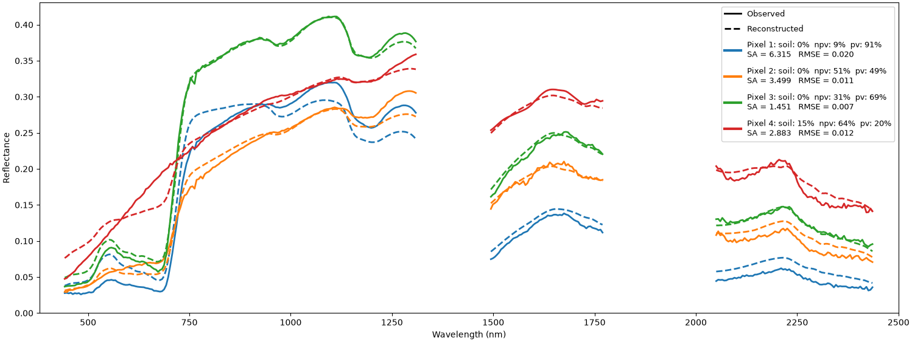

# Fractional Cover Processing for the PLANTS Database

## Description
This contains the database spectral unmixing application. The processing uses the [SpectralUnmixing Julia package](https://github.com/emit-sds/SpectralUnmixing.jl) with EMIT-like configuration.

*Figure 1. Results of the fractional cover processing for 4 database spectra.*
